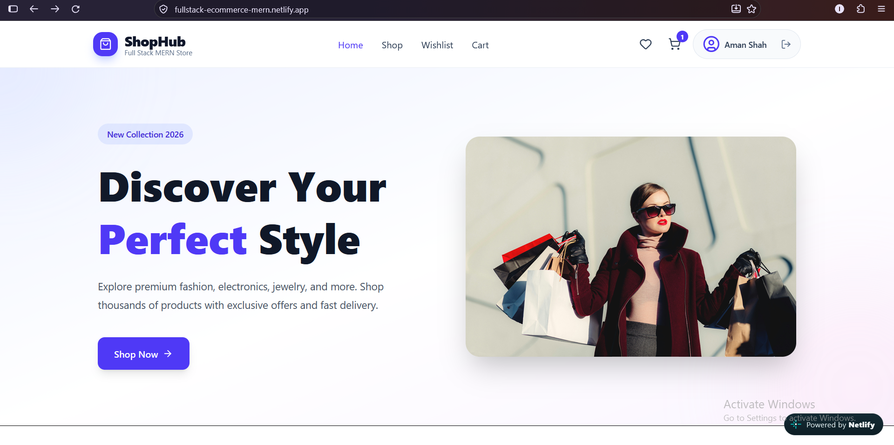
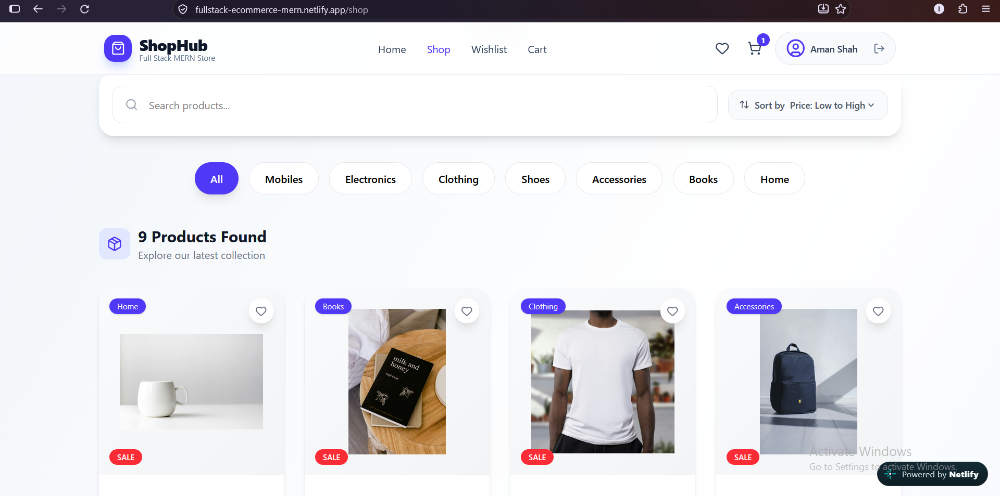
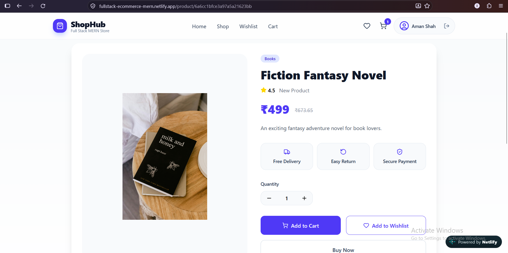
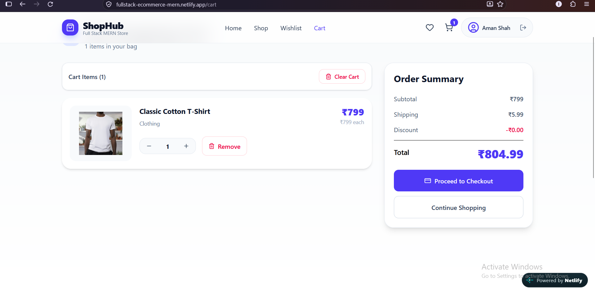
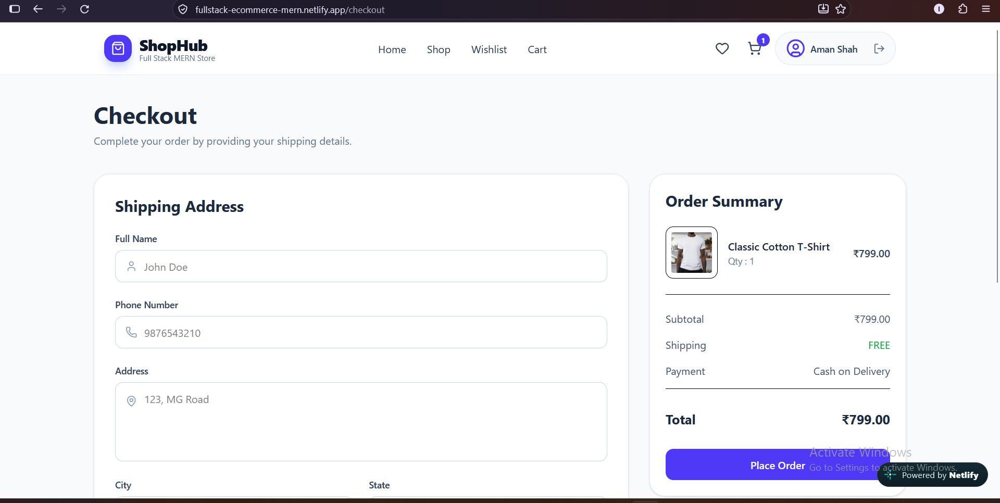

# MERN E-Commerce Platform

A full-stack e-commerce web application built with the MERN stack. The application provides a complete shopping experience with authentication, product browsing, cart and wishlist management, checkout, and order tracking.

## Live Demo

[View Live Project](https://fullstack-ecommerce-mern.netlify.app/)

## Project Highlights

- JWT-based user authentication and protected routes
- Product search, category filtering, and sorting
- Shopping cart with quantity management
- Wishlist with persistent local storage
- Checkout with shipping details and Cash on Delivery
- Order history and detailed order tracking
- Responsive user interface for different screen sizes
- Toast notifications and user-friendly alerts
- REST API integration between the React frontend and Express backend

## Screenshots

### Home Page


### Products


### Product Details


### Shopping Cart


### Checkout


## Features

- User registration and login with JWT authentication
- Browse products and view detailed product information
- Search products by keyword
- Filter products by category
- Sort products based on available options
- Add, update, and remove products from the shopping cart
- Add and remove products from the wishlist
- Protected profile and order pages
- Checkout with shipping details
- Cash on Delivery order placement
- View order history and order details
- Persistent cart and wishlist using local storage
- Responsive UI
- Toast notifications and alerts

## Tech Stack

### Frontend

- React.js
- Vite
- Tailwind CSS
- React Router
- Axios
- Lucide React
- SweetAlert

### Backend

- Node.js
- Express.js
- MongoDB
- Mongoose
- JWT
- bcrypt

## Project Structure

```text
fullstack-ecommerce-mern/
├── frontend/
└── backend/
```

## Installation & Setup

### 1. Clone the Repository

```bash
git clone https://github.com/codewithvaish/fullstack-ecommerce-mern.git
cd fullstack-ecommerce-mern
```

### 2. Setup the Backend

```bash
cd backend
npm install
```

Create a `.env` file inside the `backend` folder:

```env
PORT=5000
MONGO_URI=your_mongodb_connection_string
JWT_SECRET=your_jwt_secret
```

Start the backend server:

```bash
npm run dev
```

### 3. Setup the Frontend

Open a new terminal:

```bash
cd frontend
npm install
npm run dev
```

The frontend will then be available on the local development server provided by Vite.

## Future Improvements

- Admin dashboard and role-based administration
- Online payment gateway integration
- Product management for administrators
- Advanced order and inventory management

## Author

**Vaishali Variya**

- [GitHub](https://github.com/codewithvaish)
